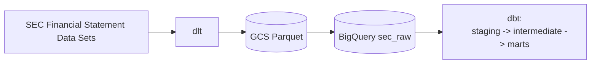

# sec-pit-warehouse

The following project is a point-in-time correct data warehouse based on the SEC financial data set. The warehouse exists to track business financial statements and what values were known as of what date. Modeling with this structure helps to prevent lookahead bias, which occurs when we model financial statements with all of today's updated values.

Interesting numbers, found from 29 quarters of filings, from 2019q1 to 2026q1, covering 45.9M facts resolved into 24.3M authoritative facts:
- 89.7% of companies (9,967 of 11,115) revised at least one previously filed fact.
- 3.57% of facts (865,755 of 24,278,748) had their value changed by a later filing.
  Those 865,755 facts were revised across 954,391 events, because a fact can be
  revised more than once.
- 50.8% of facts were re-filed at least once. But most re-filings repeat the number
  unchanged.

## Architecture
See the following diagram for a high-level overview of the project architecture:


## Source data
There are 4 tables in the SEC Dataset:
1. SUB (Submissions) - One row per filing. Holds information about the filing company (name, location, etc...) and also about information about the filing (filed date, time period, adshs (the unique ID))
2. TAG (Tags) - Contains information about a tag (a particular field) being filed
3. NUM (Numbers) - Contains the numbers for the financial facts
4. PRE (Presentation of Statements) - Contains information regarding the layout of the information in the filing form. This data was irrelevant to the purpose of the data warehouse

All the facts for this warehouse exist in the NUM table. Dimensional data regarding the company and filing time exist in the SUB table

## Modeling
Following steps are according to the Kimball four-step dimensional design process
1. **Process**
    - Company submits SEC quarterly financial filing
2. **Grain**
    - The grain for versioned facts is one numerical fact in one filing statement for one company
    - The grain for authoritative facts in one numerical fact for one company, resolved across filing statements
3. **Dimensions**
    - There is one dimension table of company with the following fields: industry, fiscal period, filing date, acceptance date, location (including sub-fields e.g. country), filer status with SEC, submission type
4. **Facts**
    - Facts for restatements table include: CIK (uniquely identifies filer), original value, revised value, delta, lag days, tag (field), unit of measure, end date, count of quarters, original accession number (identifies filing), revising accession number (identifies filing)

## dbt Models
### Staging
Pulls directly from raw data. Simply renames columns and casts to the appropriate data types. As we ignore the PRE data source (*See source data), we only have 3 staging tables:
- stg_sec__submissions - Data from the SUB table holding company information
- stg_sec__numeric_facts - Data from the NUM table holding the numerical facts and information
- stg_sec__tags - Data from the TAG table describing the fields of the numerical facts

### Intermediate
We have two intermediate tables regarding the versioning of the numerical facts:
- int_facts__versioned - This shows all versions of every fact, without resolving financial restatements
- int_facts__authoritative - This shows every fact currently held as authoritative for the current date. Filter to 'where date_filed <= [date]' to get the authoritative financial facts for a specific date.

### Marts
We have three mart tables as output:
- mart_restatement_event - A record of all restatements of fianncial facts
- mart_fct_financial - The financial facts held as authoritative for the current date.
- dim_company - Dimensional data regarding the company and the filing

## dlt Data Loading
I used dlt for staging the data in GCS and loading into BigQuery.
Loading one quarter at a time was too much data at once and the load was repeatedly failing. The data was broken into 200,000 row chunks.
The complete load took 7 hours and 30 minutes.

## Tests
The following tests were added for transform
- assert_no_lookahead: Confirms that no versioned facts are dated after the authoritative fact (as then the authoritative value was determined incorrectly)
- assert_no_future_filings: Checks that there are no filings dated after the current date
- assert_one_authoritative_value: Confirms that there is only one authoritative value per fact

## AI Use
I used Claude code for help with the following tasks:
- Infrastructure and Terraform
- Help with dlt code and ingest
- Referential queries
- YAML scaffolding

I did not use Claude to write:
- dbt SQL queries
- Data modeling
- transform tests
- Documentation

## Motivation
I built this warehouse for the following reasons:
- To gain hands-on experience with a practical data warehouse
- To learn and practice data modeling, dlt, and dbt
- To have a portfolio project in the financial sector

## Setup

Requires [uv](https://docs.astral.sh/uv/) and Python 3.12, specifically 3.12: the pinned
`duckdb==1.4.1` has no wheel for 3.13+ and will try to compile from source.

```bash
git clone https://github.com/ari-butterfield/sec-pit-warehouse.git
cd sec-pit-warehouse

uv venv --python 3.12 && source .venv/bin/activate
uv pip install -r requirements.txt

export DBT_PROFILES_DIR=$PWD/transform
# dlt keeps pipeline state in ~/.dlt by default, which makes a re-clone a silent
# no-op on a machine that has run this before. Keep the state in the clone.
export DLT_DATA_DIR=$PWD/.dlt_state
```

The warehouse itself is not in git. Seed the committed 200-row fixture quarter, the same
one CI uses, and build:

```bash
cd ingest
mkdir -p .cache && cp tests/fixtures/sample_quarter.zip .cache/1900q1.zip
python load_sec_quarter.py 1900q1 --db-path ../transform/ci.duckdb
cd ../transform && dbt deps && dbt build --target ci
```

Expected: `PASS=46 WARN=0 ERROR=0`.

To load real data instead (~4 GB per quarter downloaded from the SEC, and the SEC
fair-access policy requires the declared user agent in `ingest/.dlt/config.toml`):

```bash
cd ingest && python load_sec_quarter.py 2026q1                  # DuckDB, dev
cd ingest && python load_sec_quarter.py 2026q1 --destination bigquery
cd transform && dbt build                                        # DuckDB, dev
cd transform && dbt build --target prod                          # BigQuery
```

BigQuery needs `GOOGLE_APPLICATION_CREDENTIALS` and `GCP_PROJECT_ID`. Terraform for the
bucket, datasets, and service account is in `infra/`. Run it without the pipeline
credentials, which have no IAM rights:

Requires [uv](https://docs.astral.sh/uv/) and Python 3.12, specifically 3.12: the pinned
`duckdb==1.4.1` has no wheel for 3.13+ and will try to compile from source.

```bash
env -u GOOGLE_APPLICATION_CREDENTIALS terraform -chdir=infra apply
```

## License
[MIT](LICENSE)
